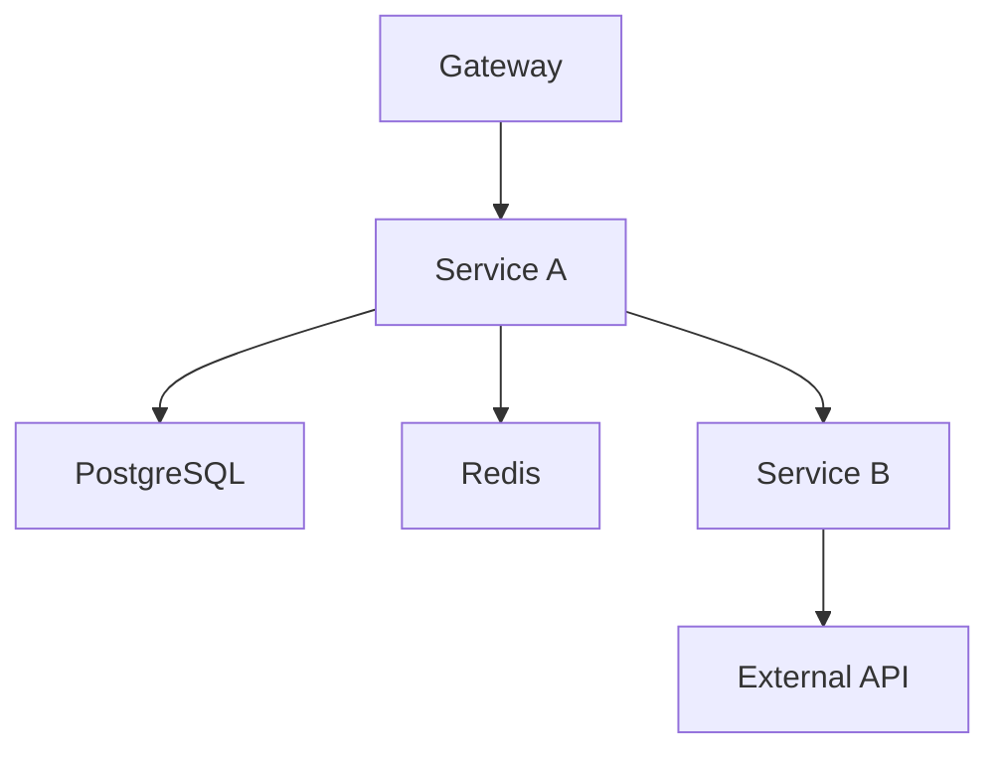
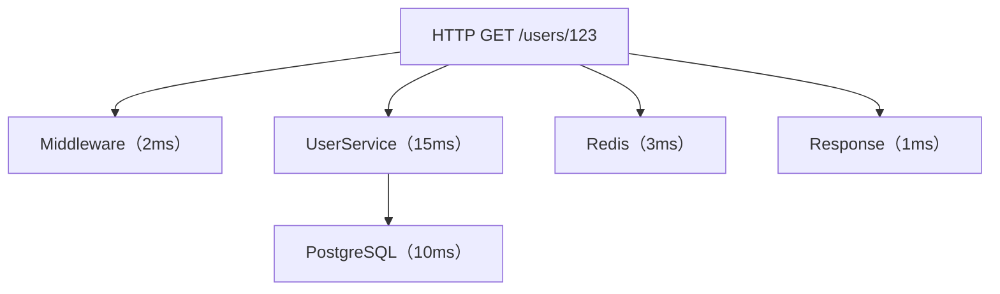
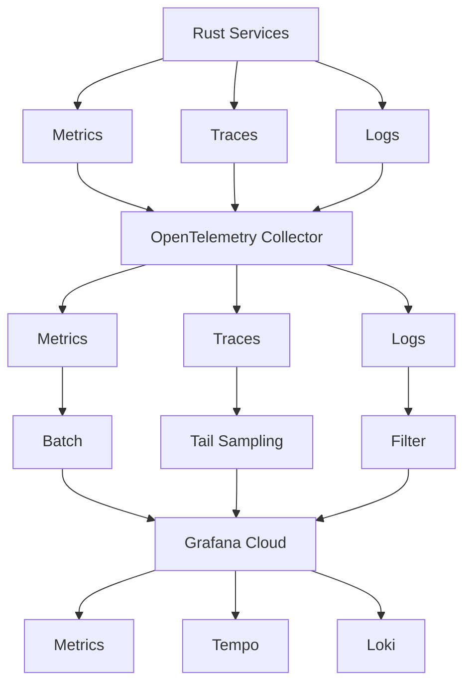
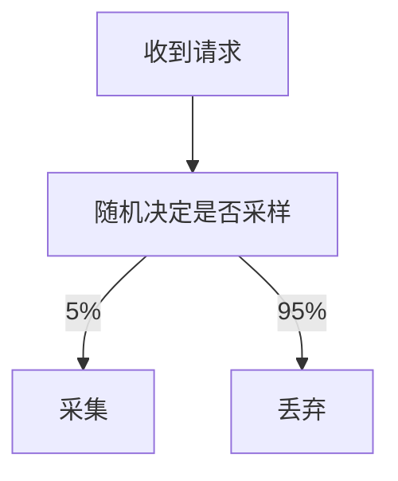
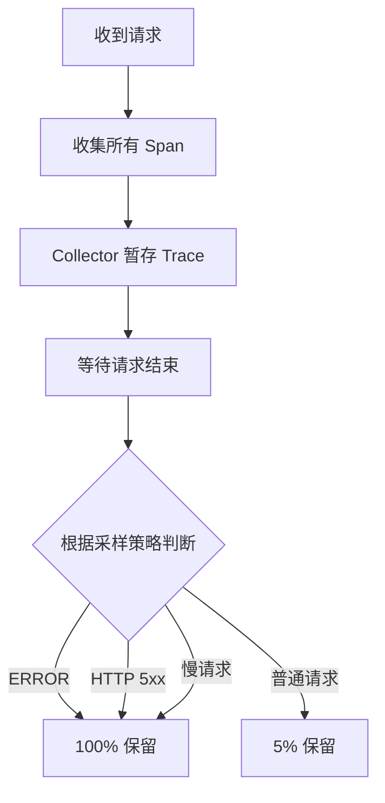
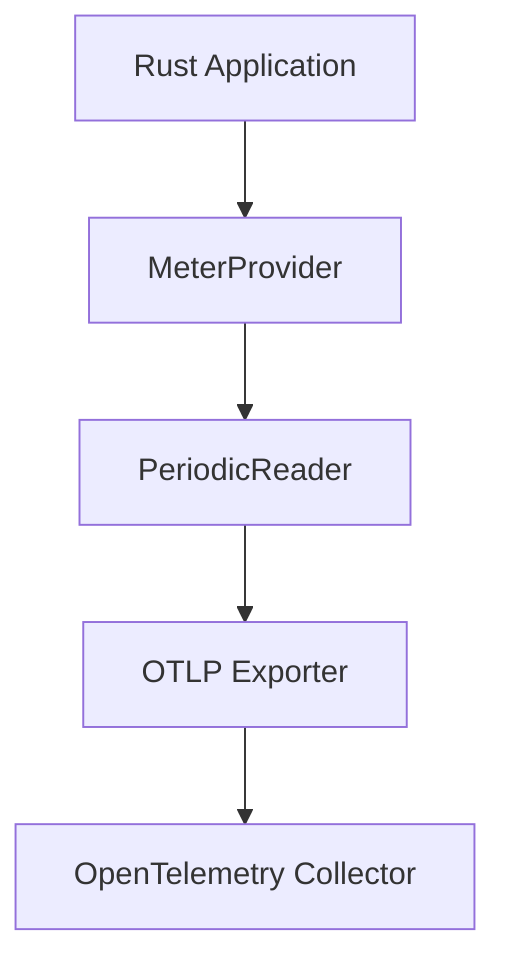
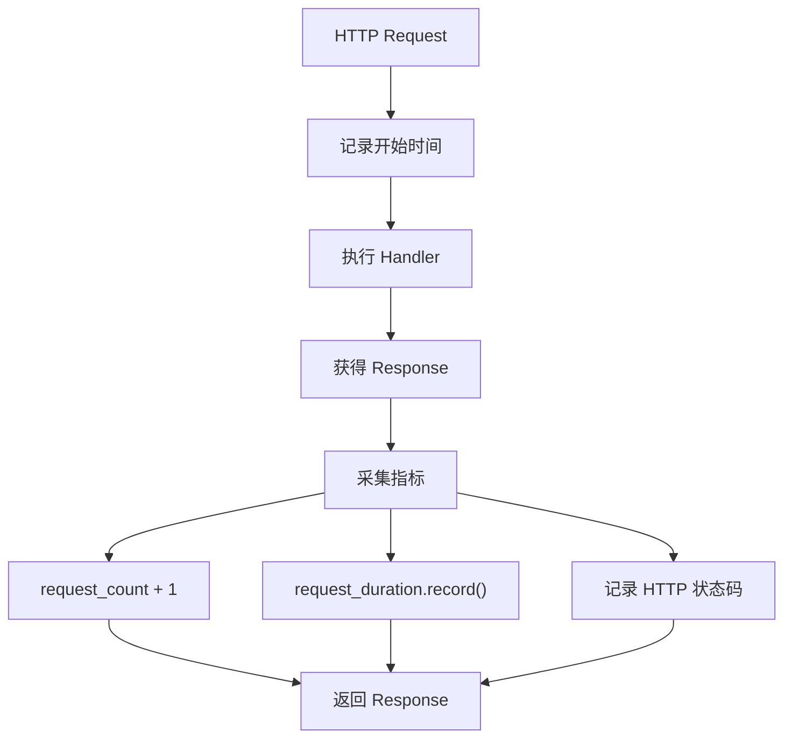
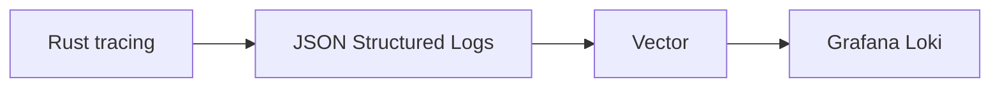

我之前写了很多篇关于分布式系统链路追踪的文章

* [OpenObserve观测平台](https://blog.hufeifei.cn/2025/07/Distribution/OpenObserve/)
* [K8S中探针请求与OTEL链路采集的问题](https://blog.hufeifei.cn/2025/06/Distribution/opentelemetry-spring-actuator/)
* [时序数据库和传统关系型数据库](https://blog.hufeifei.cn/2023/08/DB/time-series&rdbms/)
* [OpenTelemetry：一统江湖的未来](https://blog.hufeifei.cn/2021/10/Distribution/OpenTelemetry/)
* [分布式系统的可观测性](https://blog.hufeifei.cn/2021/09/Distribution/grafana/)
* [从谷歌Dapper到阿里EagleEye](https://blog.hufeifei.cn/2020/07/Alibaba/distributed-tracing/)

这篇文章的目的是总结过去踩过的坑和探索的解决方案，形成一篇最佳实践。

> AI时代，链路追踪发生了很多根本性的改变，比如session会话会跨多个API请求，这些暂时不在这篇文章的讨论范围。

## 1. 为什么需要统一的可观测性体系？

随着微服务架构的发展，一个业务请求往往需要经过多个服务、数据库、缓存和外部 API。传统的日志监控方式已经很难快速定位复杂系统中的问题。

例如，一个 HTTP 请求可能经历：



当请求出现异常时，我们通常需要回答以下问题：

- 哪个服务出现了问题？
- 请求在哪个环节耗时最长？
- 数据库查询是否出现异常？
- Redis 是否存在连接或命令超时？
- 某个错误请求经过了哪些服务？
- 系统整体的错误率和延迟是否正在恶化？

这些问题分别涉及 Metrics、Traces 和 Logs。

OpenTelemetry（简称 OTel）提供了一套统一的可观测性标准，能够将应用程序产生的指标、分布式追踪和日志数据统一采集、处理和导出<sup>[1](#ref-1)</sup>。

本文将介绍一套适用于生产环境的 OpenTelemetry 实践方案，重点讨论如何在保证可观测性的同时控制数据采集成本。

## 2. 三大可观测性信号

OpenTelemetry 的核心是三种可观测性信号：

- Metrics：指标
- Traces：分布式追踪
- Logs：日志

它们解决的是不同的问题。

| 信号 | 主要用途 | 典型数据 |
|---|---|---|
| Metrics | 观察系统整体运行状况 | QPS、错误率、P95、CPU、内存 |
| Traces | 分析单次请求的完整调用链 | HTTP 调用、SQL 查询、Redis 操作 |
| Logs | 记录具体事件和错误详情 | 异常堆栈、业务错误、操作记录 |

### 2.1 Metrics：关注整体运行状况

Metrics 是经过聚合的数值型数据，适合观察系统在一段时间内的整体表现。

例如：

- 每秒 HTTP 请求数量
- HTTP 请求错误率
- 请求延迟分布
- 数据库连接池使用率
- Redis 命令耗时
- CPU 和内存使用率

Metrics 的原始数据量其实并不小：样本数 = 活跃序列数 × 采集频率，例如 10 万条活跃序列、15 秒采集一次，一天就会产生约 5.7 亿个样本点。

但它有三个特性使单位信息的存储成本远低于 Trace：

1. **不随流量线性增长**：Metrics 按序列数（基数）计价，聚合发生在应用内——100 万个请求只是让 Counter 加 100 万，不产生 100 万条数据；而 Trace 是每个请求都生成 Span，数据量随流量 O(n) 增长。
2. **压缩率极高**：时间序列天然规律性强——等间隔时间戳、Counter 单调递增、相邻值变化小，Gorilla/XOR 等编码通常能压到每样本 1～2 字节<sup>[6](#ref-6)</sup>；而 Span 携带 trace_id、属性、事件等高熵内容，压缩率低得多。
3. **总量可预测、可控**：Metrics 体量由基数决定，通过控制标签基数可以事先封顶；Trace 体量取决于流量 × 每请求 Span 数，只能靠采样控制。

因此 Metrics 可以低成本地长期保存，并且非常适合构建 Dashboard 和告警规则。

### 2.2 Traces：分析单次请求

Trace 用于描述一次请求在分布式系统中的完整执行过程。

例如：



通过 Trace 可以直观地观察：

- 请求经过了哪些服务。
- 每个服务执行了多长时间。
- 哪个 SQL 查询耗时最长。
- 哪个下游服务发生了错误。

但 Trace 的单位存储成本远高于 Metrics，且数据量随流量线性增长。如果对所有请求进行完整追踪，可能产生较高的存储和网络成本。

因此，生产环境通常需要采用合理的采样策略。

### 2.3 Logs：记录具体事件

Logs 用于记录系统运行过程中的具体事件。

例如：

```json
{
  "timestamp": "2026-11-02T10:00:00Z",
  "level": "ERROR",
  "service": "user-service",
  "message": "database query failed",
  "trace_id": "abc123",
  "span_id": "def456"
}
```

这里最重要的是 `trace_id` 和 `span_id`。

通过这两个字段，可以将日志和分布式追踪关联起来。当发现一条错误日志时，可以直接找到对应的 Trace，进一步分析请求执行过程。

## 3. 推荐的整体架构

对于大多数中小型微服务系统，推荐采用以下架构：



这里的核心设计原则是：

**Metrics 尽可能全量采集，Traces 根据价值采样，Logs 根据级别和业务价值进行分级采集。**

三种信号分别使用独立的 Collector Pipeline，互不影响。

### 3.1 可选后端：Grafana Cloud 或 OpenObserve

上图的 Grafana Cloud 是托管方案（Prometheus 兼容 Metrics + Tempo + Loki），运维成本低但有按量计费的数据成本。

如果希望自托管、进一步降低存储成本，可以考虑 [OpenObserve](https://openobserve.ai/) 作为替代后端：

- **单一二进制**即可接收 Metrics、Traces、Logs 三种信号，原生支持 OTLP 接入，无需分别部署 Prometheus/Tempo/Loki 三套组件。
- 数据以 **Parquet 格式**存储在本地磁盘或 S3 兼容对象存储上，对象存储成本远低于专门的时序/日志数据库，适合长期保存 Trace 和日志。
- 内置 Web UI 和查询界面，同时支持 **SQL 查询**，Dashboard 与告警能力可覆盖 Grafana Cloud 的主要场景。
- 部署架构不变：应用仍只对接 OpenTelemetry Collector，只需把 Collector 各 Pipeline 的 exporter 指向 OpenObserve 的 OTLP 端点即可完成切换。

选型建议：小团队、数据量增长快、希望数据不出自有基础设施时优先考虑 OpenObserve；已经深度使用 Grafana 生态、不想运维存储层时继续使用 Grafana Cloud。

### 3.2 为什么 Metrics 全量采集？

Metrics 主要承担系统整体统计的职责。

例如，一个服务每天处理 100 万个请求：

- 请求总量需要准确统计。
- 错误率需要尽可能准确。
- 延迟分布需要有足够的统计样本。
- P95 和 P99 需要反映真实的服务表现。

因此，HTTP 请求计数器和延迟直方图应记录所有请求，而不是只记录采样后的请求。

需要注意，这里的全量采集指全量更新聚合指标，并不是每个请求都产生一条独立的 Metrics 数据。

另外，Metrics 必须控制标签基数。用户 ID、订单 ID、原始 URL 等高基数属性不应该作为 Metrics 标签。

### 3.3 为什么 Traces 需要采样？

Trace 通常包含大量 Span。

如果一个请求经过 5 个服务和 3 次数据库操作，那么一条 Trace 就可能包含多个 Span。

在高流量系统中，全量保存所有 Trace 会产生较大的成本。

但是，如果完全采用随机采样，又可能丢失最有价值的错误请求。

因此，推荐使用 Tail-based Sampling（尾部采样）。

## 4. Tail-based Sampling：智能采样

OpenTelemetry 提供了两种常见的采样方式。

### 4.1 Head-based Sampling

Head Sampling 在请求开始时决定是否采集。

例如，设置 5% 的概率采样：



它的优点是实现简单，资源消耗较低。

但它有一个明显的问题：请求刚开始时，还不知道请求最终是否成功。

因此，即使某个请求最终返回 HTTP 500，也可能在请求开始时就被随机丢弃。

### 4.2 Tail-based Sampling

Tail Sampling 在请求执行完成后，根据最终结果决定是否保留 Trace。



这使我们能够根据请求的最终状态进行更精细的采样。

### 4.3 推荐采样策略

| 请求类型 | 采样比例 |
|---|---:|
| Span Status = ERROR | 100% |
| HTTP 5xx | 100% |
| 慢请求（超过 2 秒） | 100% |
| 普通成功请求 | 5% |
| 健康检查 | 1% |

具体阈值应根据业务场景和流量调整。

### 4.4 OpenTelemetry Collector 配置

使用 OpenTelemetry Collector Contrib 版本，因为 Tail Sampling Processor 属于 Contrib 组件<sup>[2](#ref-2)</sup>。

示例配置：

```yaml
receivers:
  otlp:
    protocols:
      grpc:
        endpoint: 0.0.0.0:4317
      http:
        endpoint: 0.0.0.0:4318

processors:
  memory_limiter:
    check_interval: 1s
    limit_mib: 1200
    spike_limit_mib: 300

  tail_sampling:
    decision_wait: 30s
    num_traces: 30000
    expected_new_traces_per_sec: 500

    policies:
      # 所有 ERROR Span 对应的 Trace 全部采集
      - name: errors
        type: status_code
        status_code:
          status_codes:
            - ERROR

      # HTTP 5xx 全部采集
      - name: http-5xx
        type: numeric_attribute
        numeric_attribute:
          key: http.response.status_code
          min_value: 500
          max_value: 599

      # 慢请求全部采集
      - name: slow-requests
        type: latency
        latency:
          threshold_ms: 2000

      # 健康检查采样 1%
      - name: health-check
        type: and
        and:
          and_sub_policy:
            - name: health-route
              type: string_attribute
              string_attribute:
                key: http.route
                values:
                  - /health
                  - /ready
                  - /live

            - name: health-probability
              type: probabilistic
              probabilistic:
                sampling_percentage: 1

      # 普通请求采样 5%
      - name: normal-requests
        type: and
        and:
          and_sub_policy:
            - name: not-health-route
              type: not
              not:
                not_sub_policy:
                  name: health-route
                  type: string_attribute
                  string_attribute:
                    key: http.route
                    values:
                      - /health
                      - /ready
                      - /live

            - name: normal-probability
              type: probabilistic
              probabilistic:
                sampling_percentage: 5

  batch:
    timeout: 5s
    send_batch_size: 1024

exporters:
  otlp:
    endpoint: ${env:GRAFANA_CLOUD_OTLP_ENDPOINT}
    headers:
      Authorization: ${env:GRAFANA_CLOUD_AUTH}
    tls:
      insecure: false

service:
  pipelines:
    traces:
      receivers: [otlp]
      processors:
        - memory_limiter
        - tail_sampling
        - batch
      exporters: [otlp]
```

注意：

1. Tail Sampling 的多个顶层 Policy 是 OR 关系。
2. `decision_wait` 应覆盖请求执行时间和 Span 到达延迟。
3. `num_traces` 应根据实际吞吐量和等待时间估算。
4. HTTP 状态码属性必须与实际 instrumentation 输出一致。
5. 如果使用多个 Tail Sampling Collector，必须按照 Trace ID 路由，确保同一 Trace 的 Span 到达同一个实例。

另外，100% 采集是采样策略的目标，不代表系统在内存不足、网络中断或 Collector 故障时绝对不会丢失数据。

官方参考：[Tail Sampling with OpenTelemetry](https://opentelemetry.io/blog/2022/tail-sampling/)<sup>[3](#ref-3)</sup> 和 [Tail Sampling Processor](https://github.com/open-telemetry/opentelemetry-collector-contrib/blob/main/processor/tailsamplingprocessor/README.md)<sup>[7](#ref-7)</sup>。

## 5. Rust 应用如何接入 OpenTelemetry？

Rust 项目可以使用以下生态组件：

- `opentelemetry`：核心 API。
- `opentelemetry_sdk`：SDK 实现。
- `opentelemetry-otlp`：OTLP Exporter。
- `tracing`：Rust 结构化诊断。
- `tracing-subscriber`：日志和 Span 订阅。
- `tracing-opentelemetry`：连接 Rust tracing 与 OpenTelemetry。

建议封装统一的 Telemetry 初始化模块，避免每个服务重复实现。

本文所述的这套封装我已经实现并开源：[summer-opentelemetry](https://crates.io/crates/summer-opentelemetry)，是 [summer-rs](https://github.com/summer-rs/summer-rs) 框架（Rust 版的 Spring Boot）的可观测性插件，[文档见此](https://summer-rs.github.io/docs/plugins/summer-opentelemetry)。它把本章要介绍的核心实践都封装成了开箱即用的能力：

- **一行配置启用**：业务服务只需声明 `opentelemetry.enable = true`，Exporter（`http`/`grpc` feature）、端点、采样等均通过 OTel 标准环境变量配置，与本章“应用端不动、策略集中在 Collector”的原则一致。
- **统一初始化三种信号 Provider**：自动完成 TracerProvider / MeterProvider / LoggerProvider 的构建（TracerProvider 使用 `AlwaysOn` 采样，采样决策交给 Collector），并通过 `tracing-opentelemetry` 的三个 Layer 挂接到 `tracing` 生态，注册 shutdown hook 在应用退出时 flush，避免丢失尾部数据。
- **HTTP Trace 中间件**：内置 `HttpLayer`（server/client 双端）自动创建遵循 Semantic Conventions 的 Span，记录状态码、路由、异常信息，支持通过 `OTEL_INSTRUMENTATION_HTTP_*_CAPTURE_*_HEADERS` 环境变量按需捕获请求/响应头。
- **HTTP Metrics 中间件**：内置 `metrics::HttpLayer` 自动记录请求数量、耗时直方图、活跃请求数、请求/响应体大小等指标，命名同样遵循 Semantic Conventions。
- **上下文传播**：默认 W3C Trace Context，可通过 feature 切换 Jaeger / Zipkin（B3）格式，兼容存量系统。

后文 5.1～5.3 节介绍这些能力背后的原理与手动实现方式；如果是 summer-rs 项目，直接引入插件即可，无需重复实现。

### 5.1 初始化 TracerProvider

因为采样决策交给 Collector，所以应用端必须完整生成 Trace。

核心配置：

```rust
let provider = SdkTracerProvider::builder()
    .with_sampler(Sampler::AlwaysOn)
    .build();
```

这里必须使用 `AlwaysOn`，不能在 SDK 端先使用 5% 的概率采样。

否则，被 SDK 丢弃的 Trace 永远无法到达 Collector，也就无法执行 Tail Sampling。

### 5.2 初始化 MeterProvider

通过 OTLP Exporter 将 Metrics 发送给 Collector。

核心结构：



建议设置 10～30 秒的指标导出周期，具体取决于监控实时性要求和数据量。

### 5.3 HTTP Middleware 自动采集

不要让每个 Handler 手动记录 Metrics。

应该通过统一的 Axum Middleware 自动采集：



推荐采集以下指标：

| 指标 | 类型 | 说明 |
|---|---|---|
| HTTP 请求数量 | Counter | 请求总量 |
| HTTP 请求延迟 | Histogram | 延迟分布 |
| HTTP 活跃请求数 | UpDownCounter | 当前并发请求 |
| HTTP 错误数量 | Counter | 错误请求数量 |

优先使用 OpenTelemetry HTTP Semantic Conventions 定义的标准属性和指标名称<sup>[5](#ref-5)</sup>，避免自定义一套不兼容的命名规范。

### 5.4 数据库和缓存监控

对于 Rust 后端，建议进一步增加：

| 组件 | 推荐监控内容 |
|---|---|
| SQLx | 连接池 active、idle、等待连接数 |
| PostgreSQL | 查询耗时、连接数、事务数 |
| Redis | 命令耗时、连接数、错误数 |
| Tokio | Runtime 任务数、调度延迟 |
| Process | CPU、内存、线程数 |

数据库和 Redis 的调用还应该创建对应的 Span，以便在 Trace 中分析下游调用耗时。

## 6. Logs 与 Traces 关联

日志不一定要全部通过 OpenTelemetry Collector 发送。

如果系统已经使用 Vector，可以继续保留 Vector 作为日志采集和转发工具。

推荐架构：



重点是让日志包含：

- `service.name`
- `trace_id`
- `span_id`
- `severity`
- `timestamp`

通过 Trace ID，可以将日志和 Trace 关联起来。

对于已经有 Vector 的系统，没有必要为了统一而强行替换它。

## 7. Grafana/OpenObserve Dashboard 设计

建议至少建立四个 Dashboard。

### 7.1 服务总览

核心指标：

- QPS
- HTTP 错误率
- P50 / P95 / P99
- 活跃请求数
- CPU 使用率
- 内存使用率

### 7.2 数据库监控

核心指标：

- SQLx 连接池使用率
- 等待连接数量
- PostgreSQL 慢查询
- Redis 命令延迟
- Redis 连接错误

### 7.3 基础设施监控

核心指标：

- Docker 容器 CPU
- Docker 容器内存
- 容器重启次数
- 节点磁盘使用率
- 网络流量

### 7.4 分布式追踪

核心内容：

- 错误 Trace
- 慢请求 Trace
- 服务间调用关系
- SQL 和 Redis 下游调用耗时
- Trace 与 Logs 关联

## 8. 告警策略

监控系统不能只是展示数据，还需要主动发现问题。

建议设置以下初始告警规则：

| 告警条件 | 建议阈值 | 级别 |
|---|---|---|
| HTTP 5xx 错误率 | 超过 5%，持续 5 分钟 | Critical |
| HTTP P95 | 超过 1 秒，持续 5 分钟 | Warning |
| HTTP P99 | 超过 3 秒，持续 5 分钟 | Critical |
| SQLx 连接池使用率 | 超过 80% | Warning |
| Redis 连接失败 | 持续发生 | Critical |
| CPU 使用率 | 超过 85%，持续 5 分钟 | Warning |
| 内存使用率 | 超过 90% | Critical |
| 磁盘使用率 | 超过 85% | Warning |

错误率告警应该设置最小请求量门槛，避免低流量服务偶发错误造成误报。

## 9. 生产环境部署注意事项

### 9.1 Collector 应该独立部署

建议将 OpenTelemetry Collector 作为独立基础设施服务部署，而不是把采样逻辑放进业务服务。

这样可以统一管理：

- 采样规则
- 数据过滤
- 数据批处理
- 导出目标
- 内存限制

业务服务只负责产生并发送数据。

### 9.2 Tail Sampling 需要考虑水平扩展

Tail Sampling 是有状态的。

同一条 Trace 的所有 Span 必须进入同一个 Collector，否则可能出现 Trace 不完整、采样判断不准确等问题。

多个 Collector 实例之间应使用基于 Trace ID 的负载均衡路由。

### 9.3 监控 Collector 自身

Collector 也是生产系统的一部分，需要监控：

- 内存使用率
- CPU 使用率
- 接收 Span 数量
- 导出成功和失败数量
- 采样决策数量
- 丢弃的数据量
- 导出队列长度

尤其要关注内存限制和导出失败，避免观测系统自身成为数据丢失的原因。

### 9.4 不要忽略高基数问题

Metrics 中不要使用：

- 用户 ID
- 订单 ID
- 请求 UUID
- 原始 URL
- SQL 原文

这些属性适合放在 Trace 或 Logs 中，而不是 Metrics 标签。

## 10. 推荐的落地路线

对于中小型 Rust 微服务项目，建议分阶段建设。

**第一阶段：统一基础设施**

- 部署 OpenTelemetry Collector。
- 配置 OTLP 接收器。
- 配置 Metrics Pipeline。
- 配置 Tail Sampling Pipeline。
- 接入 OpenObserve。

**第二阶段：统一 Rust SDK**

- 封装 TracerProvider。
- 封装 MeterProvider。
- 统一 OTLP Exporter。
- 配置统一 Resource。
- 实现 Axum HTTP Middleware。

**第三阶段：完善组件监控**

- SQLx 连接池指标。
- Redis 指标。
- PostgreSQL 指标。
- Tokio Runtime 指标。
- gRPC 指标。

**第四阶段：完善可观测性平台**

- OpenObserve。
- Trace 与 Logs 关联。
- 错误率告警。
- 延迟告警。
- Collector 自身监控。

## 11. 总结

一套好的可观测性体系，不应该追求采集尽可能多的数据，而应该在数据价值、系统开销和排障效率之间取得平衡。

本文推荐的核心实践可以概括为：

1. **Metrics 全量聚合采集**：准确观察系统整体运行状态。
2. **Traces 使用 Tail Sampling**：错误请求、慢请求全部保留，普通请求按比例采样。
3. **Logs 分级采集**：保留关键错误和业务事件，通过 Trace ID 关联调用链。
4. **Collector 统一处理**：将采样、过滤和导出策略集中管理。
5. **Rust SDK 统一封装**：让业务服务无需重复实现可观测性基础设施。

对于 Rust 微服务项目，进一步将这些能力封装成统一的基础设施组件，可以让所有业务服务以一致的方式获得 Metrics、Traces 和 Logs 能力。

最终目标不是简单地把数据送进 OpenObserve，而是建立一套低成本、可扩展、能够快速定位生产问题的可观测性体系。

---

## 参考资料

1. <a id="ref-1"></a>[OpenTelemetry 官方文档](https://opentelemetry.io/docs/)
2. <a id="ref-2"></a>[OpenTelemetry Collector](https://opentelemetry.io/docs/collector/)
3. <a id="ref-3"></a>[Tail Sampling with OpenTelemetry](https://opentelemetry.io/blog/2022/tail-sampling/)
4. <a id="ref-4"></a>[OpenTelemetry Rust](https://opentelemetry.io/docs/languages/rust/)
5. <a id="ref-5"></a>[OpenTelemetry Semantic Conventions](https://opentelemetry.io/docs/specs/semconv/)
6. <a id="ref-6"></a>Pelkonen, T., Franklin, S., Teller, J., Cavallaro, P., Huang, Q., Meza, J., Veeraraghavan, K. "Gorilla: A Fast, Scalable, In-Memory Time Series Database." *Proceedings of the VLDB Endowment*, Vol. 8, No. 12, 2015. [论文 PDF](http://www.vldb.org/pvldb/vol8/p1816-teller.pdf)（XOR 数值编码与 delta-of-delta 时间戳编码的出处，实测平均约 1.37 字节/样本；Prometheus TSDB 的 chunk 编码亦源于此）
7. https://github.com/open-telemetry/opentelemetry-collector-contrib/blob/main/processor/tailsamplingprocessor/README.md
8. https://github.com/open-telemetry/opentelemetry-collector-contrib/blob/main/processor/tailsamplingprocessor/documentation.md
